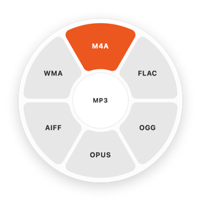
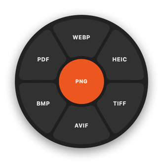

# rishabhfc

A tiny drag-and-tap file converter for macOS, modeled on [Tangerine](https://tangerineformac.com). Start dragging any file, tap **Shift**, and a wheel of formats opens under the cursor. Drop on a format and the converted copy appears next to the original.

<p>
  
  
</p>

Everything runs on your Mac. Nothing is uploaded.

## Highlights

- **Three wheels, one gesture.** While dragging, tap:
  - `⇧` Shift: **convert** to another format
  - `⌘` Command: **tools** (compress, strip metadata, resize, rotate, combine, split, merge, mute)
  - `⌃` Control: **file actions** (AirDrop, Float, Copy, Move, Copy Path, Terminal)
- **Drop to pick.** The hub holds the most likely format, so a drop right where the wheel opened works. Hovered slices light up tangerine. Tap the same key again to close the wheel, or another key to switch.
- **Never destructive.** Outputs go beside the source as `photo.png`, then `photo 2.png`, and so on. Nothing is overwritten.
- **Adapts to the file.** The wheel shows only formats that make sense for what you're dragging. For a multi-file drag it shows the formats every file shares, plus ZIP.
- **Lightweight:**
  - ~600 KB native Swift app, ~45 MB of memory when idle.
  - No dependencies.
  - Needs no Accessibility, Input Monitoring or Screen Recording permission.
  - Idle when you're not dragging.
- **Better with Homebrew.** If `ffmpeg` and `cwebp` are installed, it uses them for more formats. Without them it falls back to the built-in AVFoundation, afconvert and ImageIO.

## Install

Requires macOS 14+ and the Swift toolchain (`xcode-select --install`).

```bash
git clone https://github.com/rishabh-tole/rishabh-tools.git
cd rishabh-tools/rishabhfc
./scripts/install.sh
```

The script installs `~/Applications/rishabhfc.app` and a LaunchAgent, which starts it at login and restarts it if it crashes. A menu bar icon (⟳) shows the keys and which encoders were found.

For every format, also install the optional encoders:

```bash
brew install ffmpeg webp
```

The first time you convert something on the Desktop or in Documents or Downloads, macOS asks once whether rishabhfc may save files there. The app is signed with the same stable local certificate as rishabhwm, so the answer survives reinstalls.

To update, run `git pull && ./scripts/install.sh`. To uninstall, run `./scripts/uninstall.sh`.

## Formats

| Source | Convert to | Notes |
|---|---|---|
| Images: JPG, PNG, WebP, HEIC, TIFF, AVIF, BMP, GIF, SVG… | JPG, PNG, WebP, HEIC, TIFF, AVIF, BMP, PDF | WebP needs `cwebp` or `ffmpeg`. EXIF orientation is applied. Metadata is kept. |
| Video: MP4, MOV, M4V, MKV, WebM, AVI… | MP4, MOV, MKV, WebM, AVI, GIF, MP3, M4A | Without ffmpeg: MP4, MOV, GIF and M4A, from MP4/MOV/M4V only. |
| Audio: MP3, M4A, WAV, FLAC, OGG, Opus, AIFF, WMA… | MP3, M4A, WAV, FLAC, OGG, Opus, AIFF, WMA | Without ffmpeg: M4A, WAV, FLAC and AIFF, using afconvert. |
| PDF | DOCX, JPG, PNG, TXT, RTF, HTML | Pages are rendered at 300 DPI. A multi-page PDF exports into a folder. |
| Documents: DOCX, DOC, ODT, RTF, RTFD, HTML, TXT, Markdown | PDF, DOCX, RTF, TXT, HTML, ODT | |
| CSV ⇄ TSV | | |
| Subtitles: SRT ⇄ VTT | SRT, VTT, TXT | TXT keeps only the spoken lines. |
| Archives: ZIP, TAR, TAR.GZ, GZ | Extract, ZIP ⇄ TAR.GZ | A single top-level item is lifted out of the extract folder, like Archive Utility. |
| Folders and any other file | ZIP, TAR.GZ | Several files become `Archive.zip`. |

### Tools (`⌘`)

| Kind | Tools |
|---|---|
| Images | **Compress**: longest side capped at 2048 px, quality 60%. **Metadata**: strips EXIF and GPS. **Resize** to half size. **Rotate** 90° clockwise. **Combine** a selection into one PDF. |
| PDF | **Compress** images. **Split** into one PDF per page. **Merge** a selection. |
| Video | **Compress**: capped at 1080p, H.264 CRF 28, or HEVC without ffmpeg. **Mute**: removes the audio without re-encoding. |

### File actions (`⌃`)

AirDrop, **Float** (a small always-on-top shelf to drag the files out of later), Copy (files to the clipboard), Move (pick a folder), Copy Path, and Terminal (opens the folder in iTerm2 if installed, otherwise Terminal).

## Command line

The app binary can also run jobs headlessly, which is handy for scripts:

```bash
~/Applications/rishabhfc.app/Contents/MacOS/rishabhfc --run convert webp ~/Desktop/photo.png
~/Applications/rishabhfc.app/Contents/MacOS/rishabhfc --run tools compress ~/Movies/clip.mov
```

`--snapshot <out.png> <light|dark> <slot> <mode> <file>` renders the wheel to a PNG. The images above were made this way.

## How it works

- A global **mouse-down monitor** starts a 60 Hz poll that runs only while the button is held. Mouse monitors don't need Accessibility. The poll checks whether the system **drag pasteboard** changed, which means a drag started, and reads its file URLs. It also watches the modifier keys.
- When a modifier is tapped, a borderless, non-activating **panel** opens centered on the cursor. It sits above full-screen apps and every Space. The panel is a regular drop target. Hovering hit-tests the hub and ring slices, and dropping hands the files and the chosen slice to a job.
- Jobs run on a background queue. Each kind of file has its own engine:
  - Images: ImageIO, plus cwebp for WebP.
  - Video and audio: ffmpeg, or AVFoundation and afconvert without it.
  - PDF: PDFKit.
  - Documents: NSAttributedString, plus the print system for PDF output.
  - Archives: `ditto`, `zip` and `tar`.

  A toast under the wheel shows progress and the result. Click it to reveal the output in Finder.

| Path | What |
|---|---|
| `Sources/RishabhFCCore/` | Pure logic, unit tested: format catalog, wheel hit-testing, output naming, CSV/TSV and subtitle conversion |
| `Sources/rishabhfc/DragWatcher.swift` | Detects file drags and modifier taps |
| `Sources/rishabhfc/WheelView.swift`, `WheelController.swift` | Drawing the wheel and taking the drop |
| `Sources/rishabhfc/*Engine.swift`, `Jobs.swift` | Conversions and tools |
| `Sources/rishabhfc/FileActions.swift`, `FloatShelf.swift` | The Control wheel |

## Development

```bash
./scripts/test.sh                     # core unit tests (no Xcode needed)
swift build && RISHABHFC_DEBUG=1 .build/debug/rishabhfc    # run with debug logging
RISHABHFC_NATIVE=1 .build/debug/rishabhfc --run convert gif clip.mov   # test the no-ffmpeg fallbacks
```

The log is at `~/Library/Logs/rishabhfc.log`. Menu bar → **Open Log** opens it.

## Differences from Tangerine

rishabhfc is deliberately small, so it leaves some things out:

- **No arrow-key/Enter selection.** Tangerine supports picking a slice with the keyboard mid-drag. That would need Input Monitoring, so here you drop on a slice instead.
- **No editors.** Tangerine has editing windows (crop, annotate, redact, add a background, trim). These tools are one-shot.
- **No Office or EPUB formats.** PPTX, XLSX, EPUB and Pages conversions are not supported.
